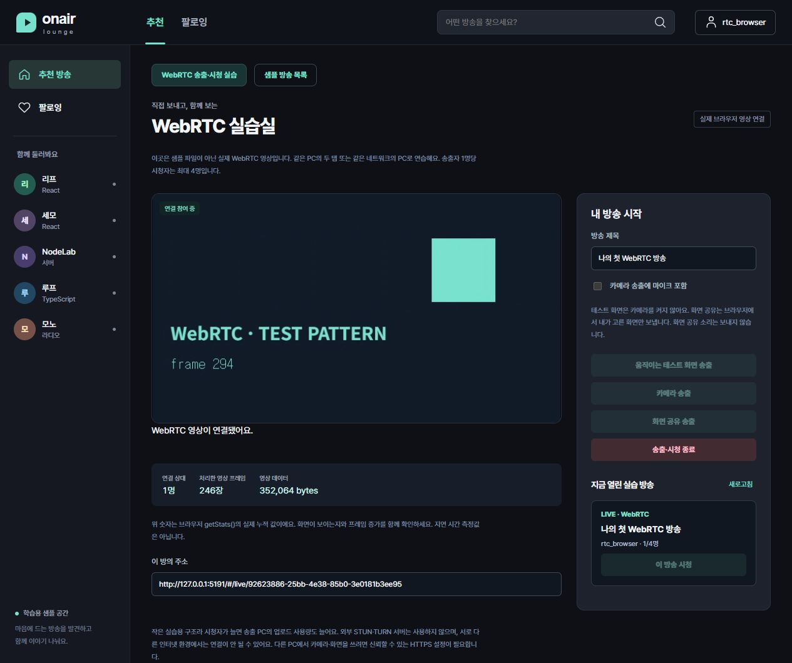

# WebRTC 실습 제작자 검증

기준일2026-10-21. 사용자 ‘WebRTC 송출·시청 실습 추가’ 승인에 따른 별도 실습입니다. 학습자는0·미시작입니다. [계획](../superpowers/plans/2026-10-21-webrtc-practice.md)·[과제](../tasks/webrtc-01/README.md)·[쉬운 설명](../tasks/webrtc-01/lesson.md).

## 범위

apps/broadcast의 WebRTC 실습실과 독립 시작 코드·참고 완성본을 제작했습니다. /rtc.io의 별도 엔진과 /rtc namespace를 사용하고 기존 채팅8KB 제한을 유지합니다. 서버 방5개·시청자4명/방·연결20개·SDP20,000자·메시지32KB·소켓20요청/초·대기4개를 제한합니다. 한 계정당 송출1개이며 공개 목록에 계정 ID·소켓 ID·SDP를 넣지 않습니다.

로그인 세션은 연결 시·요청 시·수신 대상 전달 전·1초 주기 재검사합니다. offer/answer는 같은 방의 올바른 방향만 전달합니다. 비동기 ICE 대기는8초·취소·완료 시 모두 정리하고 연결 준비는20초, 연결 끊김은10초 후 정리합니다. 소스 정지·peer 닫기·소켓·타이머·srcObject 해제를 제공하며 취소 뒤 도착한 캡처도 즉시 멈춥니다.

## 실행한 검사

- 입력·방 소유권·상한·다른 방 중계 거부·퇴장·LAN 출처7개.
- ICE 완료/취소/시간 제한과 이벤트 정리, 트랙/그림 타이머/peer 해제, 로그아웃 뒤 늦은 응답·다른 방 SDP 무시·시청 응답12개.
- 실제 일회용 PostgreSQL18.6·제한 역할·HTTP 가입/로그인/CSRF·실제 Socket.IO9항목. 익명·틀린/없는 Origin 거부, 사용자 사칭 필드 거부, 등록/중계 방향, 로그아웃한 시청자 차단, 송출 종료 전파를 확인합니다. HTTPS 프록시 조건에서 Secure/HttpOnly/SameSite=Lax 쿠키를 확인하되 실제 TLS 연결 검증으로 세지 않습니다.
- 시작 코드:19개 중13통과·6의도된 TODO 실패. 참고 완성본:19통과. 과제는 gatherIce·authorizeSignal 두 곳입니다.
- 실제 새 설치·빌드·독립 복사본 결과와 원시 로그는 [실행 증거 폴더](../experiments/webrtc-01/)에 기록합니다. npm run verify:webrtc-01:standalone은 저장소 밖 새 설치·typecheck·server/client build·19단위·실제 DB/HTTP/소켓9검사를 실행합니다. 브라우저 영상 전달은 별도입니다.

## 실제 브라우저

CUA로 loopback5191 UI/API3007의 별도 일회용 DB 환경을 실행했습니다. 기존 개발 포트와 분리하기 위한 검사 포트이며 제품 기본은5190/3006입니다. 테스트 계정만 만들고 별도 r1 관리자/회원 권한을 부여하지 않았습니다. 카메라나 개인 화면은 수집하지 않고 canvas.captureStream(10)으로 만든 움직이는 화면을 실제 두 탭에서 송수신했습니다.

- 최종 코드 새로고침 후 시청 탭의 실제 videoWidth640·videoHeight360·readyState4·paused false를 확인했습니다. src 파일 주소는 없습니다.
- getStats 누적 수신246프레임·352,064bytes를 관찰한 뒤 모바일에서306프레임·435,512bytes로 증가했습니다. 이는 지연 측정이나 성능 수용 인원 결과가 아닙니다.
- 모바일 viewport360에서 실제 clientWidth345/scrollWidth345로 가로 넘침이 없고 영상 수신이 이어졌습니다.
- 송출 중지 시 시청 탭의 종료 안내와 방 제거를 확인했습니다. 재송출·재시청도 확인했습니다. 시청 탭 새로고침 후 송출자의 등록0명·peer0명을 확인했고 다시 접속했습니다. 송출 탭 로그아웃 후 다른 탭도 연결 종료·방0개·peer0명·영상 readyState0/paused true/크기0으로 정리됐습니다. 다른 탭의 계정 메뉴는 ‘계정 다시 확인’으로 갱신하는 기존 흐름입니다. [원시 관찰](../experiments/webrtc-01/browser.json).

## 검증하지 않은 조건과 한계

물리 PC 두 대·실제 카메라·마이크·화면 선택·신뢰 인증서·LAN HTTPS는 자동 검증하지 않았습니다. 사용자가 자신의 장치에서 직접 선택하고 확인하는 절차를 교재에 제공합니다. 인증서 경고를 우회하거나 방화벽·공개 포트를 자동 개방하지 않았습니다.

iceServers는 빈 배열이며 외부 STUN/TURN을 호출하지 않습니다. 같은 네트워크에서도 기기 격리·방화벽·브라우저 조건 때문에 연결되지 않을 수 있습니다. 송출자가 각 시청자에게 보내는 소규모 구조이고 시청자끼리 재전송하지 않습니다. SFU·CDN·P2P 트래픽 절약·방송 저장·다중 화질·운영 수준 검증을 주장하지 않습니다. 기존 여섯 샘플 방송과 별도 영상 실습방이며 라이브 방별 DB 채팅/알림함은 이번 추가 구현에 포함하지 않았습니다. 원래 알림5~7주·프론트 보안3강과 최종 통합은 계속 남아 있습니다.

Code review: skipped (ce-code-review unavailable)
